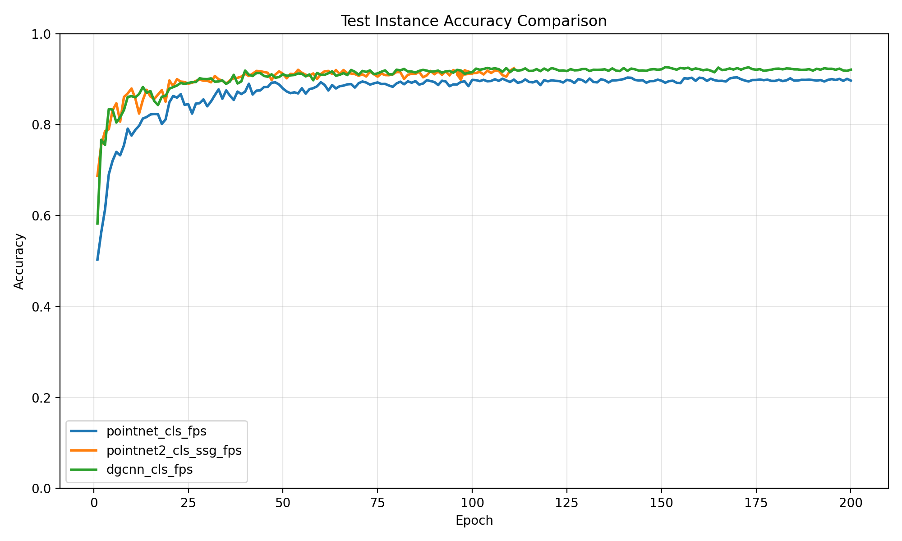

# Point Cloud Classification

基于 PyTorch 的三维点云分类项目，在 ModelNet10/40 上实现并比较 PointNet、PointNet++ SSG/MSG 与 DGCNN。项目包含训练、投票评估、错误案例分析和训练曲线可视化工具。



## 主要功能

- 支持 `pointnet_cls`、`pointnet2_cls_ssg`、`pointnet2_cls_msg` 和 `dgcnn_cls`
- 支持最远点采样（FPS）、法向量输入和离线数据预处理
- 支持 early stopping、断点续训和多次投票评估
- 输出混淆矩阵、逐类别准确率、主要混淆类别和错误样本
- 从训练日志生成单模型曲线与多模型对比图

## 实验结果

以下结果使用 ModelNet40、1,024 个采样点、FPS 和 3 次投票得到。不同硬件、随机种子和训练轮数可能产生略微差异。

| 模型 | Instance Accuracy | Class Accuracy |
| --- | ---: | ---: |
| PointNet | 90.06% | 86.39% |
| PointNet++ SSG | 92.35% | 88.53% |
| DGCNN | **92.85%** | **89.74%** |

更完整的实验说明见 [docs/RESULTS.md](docs/RESULTS.md)。

## 项目结构

```text
.
├── data_utils/               # ModelNet 数据加载器
├── models/                   # 点云分类模型及公共模块
├── docs/                     # 结果说明与轻量级展示资源
├── train_classification.py   # 训练入口
├── test_classification.py    # 测试/投票评估入口
├── analyze.py                # 混淆矩阵与错误样本分析
├── visualize_training.py     # 训练曲线可视化
├── provider.py               # 点云数据增强
└── requirements.txt
```

`data/`、`log/` 和模型权重默认被 Git 忽略，避免把大型数据集和训练产物提交到仓库。

## 环境安装

建议使用 Python 3.10 或更高版本，并根据自己的 CUDA 环境先从 [PyTorch 官网](https://pytorch.org/get-started/locally/) 安装匹配的 PyTorch，然后安装其余依赖：

```bash
python -m venv .venv
# Windows PowerShell
.venv\Scripts\Activate.ps1
pip install -r requirements.txt
```

CPU 环境也可以运行，但训练速度会明显较慢；命令中加入 `--use_cpu` 即可。

## 准备数据集

下载 ModelNet40 normal-resampled 数据集并解压为：

```text
data/
└── modelnet40_normal_resampled/
    ├── modelnet40_shape_names.txt
    ├── modelnet40_train.txt
    ├── modelnet40_test.txt
    └── airplane/
        └── ...
```

如果数据位于其他目录，请通过 `--data_path` 指定路径。ModelNet10 可通过 `--num_category 10` 使用。

## 训练

```bash
# PointNet + FPS
python train_classification.py --model pointnet_cls --use_uniform_sample --process_data --log_dir pointnet_cls_fps

# PointNet++ SSG + FPS
python train_classification.py --model pointnet2_cls_ssg --use_uniform_sample --process_data --log_dir pointnet2_cls_ssg_fps

# DGCNN + FPS
python train_classification.py --model dgcnn_cls --use_uniform_sample --process_data --log_dir dgcnn_cls_fps
```

常用参数：

```text
--data_path PATH       数据集目录
--epoch N              最大训练轮数（默认 200）
--batch_size N         batch size（默认 24）
--num_point N          每个样本的点数（默认 1024）
--patience N           early stopping 耐心值；<=0 表示关闭
--num_workers N        DataLoader 工作进程数
--use_cpu              使用 CPU
--use_normals          使用法向量
```

训练输出保存在 `log/classification/<log_dir>/`。

## 评估与分析

```bash
# 三次投票评估
python test_classification.py --log_dir dgcnn_cls_fps --use_uniform_sample --num_votes 3

# 生成混淆矩阵、逐类别准确率和错误案例
python analyze.py --log_dir dgcnn_cls_fps --use_uniform_sample --num_votes 3

# 绘制训练曲线和模型对比图
python visualize_training.py --log_dirs pointnet_cls_fps pointnet2_cls_ssg_fps dgcnn_cls_fps
```
